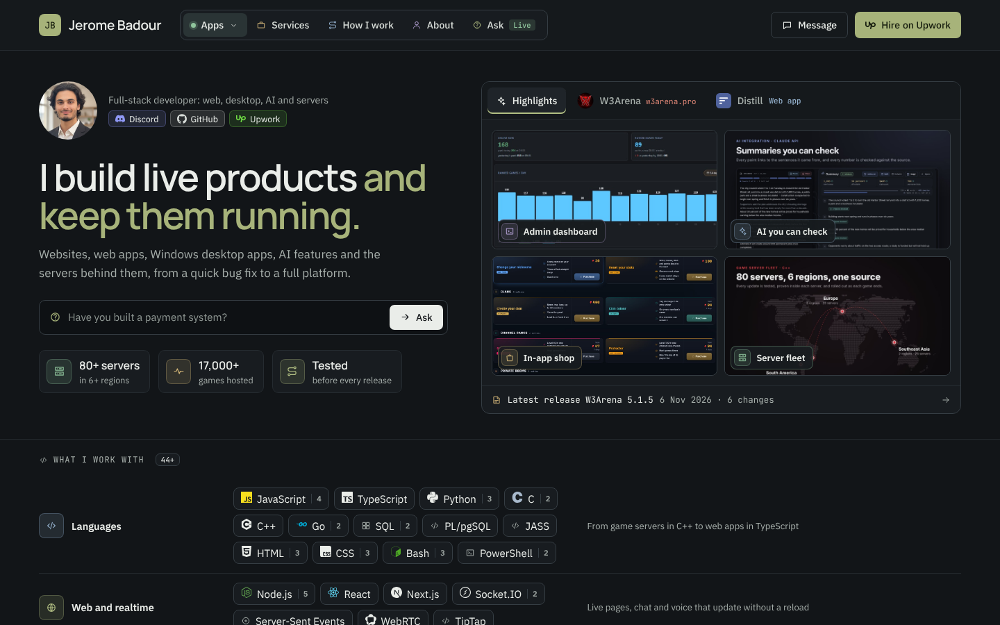
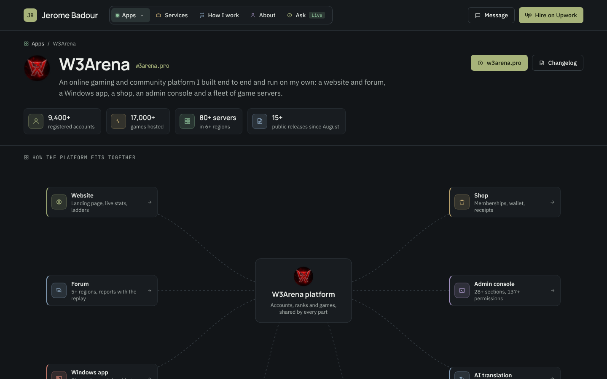

# jeromebadour.com

The portfolio site of **Jerome Badour**, full-stack developer: websites, web apps, Windows desktop apps, AI features
and the servers behind them.

It is built like the products it shows: every claim on it carries its proof, and that proof is a live site, a public
release, a demo, the code or a real screen.



## What is on it

- **The apps, shown as they really are.** W3Arena is an online gaming and community platform I built end to end and
  run on my own: a website and forum, a Windows app, a shop, an admin console and a fleet of game servers. Each part
  has its own page with the need, what was built, the result and its real screens. Distill is a web app whose AI
  summaries trace every point back to its source.
- **What I work with.** 44+ languages, libraries and services in 8 groups. Every one of them links to the pages where
  it is used, so nothing on that list is a keyword without a project behind it.
- **Services and How I work.** What to hire me for, each offer next to the work that proves it, and how I deliver
  work, each promise with its proof.
- **Ask about my work.** A question in plain words gets an answer drawn only from this site's pages, each point with
  links to its proof. The answer can become a short brief and a message, and every message gets a status page:
  Received, Read, Replied.
- **Proposal pages.** A page made for one Upwork job: a short note and the three proofs that fit it. The conversation
  stays on Upwork.
- **Plain legal pages.** A privacy policy and terms of use that say what the site really keeps and for how long.



## Where it stands

Every page is built. Ask, messages, proposal pages and the owner console show their approved designs and are being
connected to the model, the database and email now.

## How it is built

- **Next.js and TypeScript**, one shared header, footer and phone tab bar, and every page at a real address.
- **Every link in one place** (`lib/links.ts`): a proof chip with no address fails the build.
- **Three screen sizes from the start:** phone, laptop and desktop, measured so nothing spills off the screen.
- **Brands only with their official marks** ([Simple Icons](https://simpleicons.org)), never redrawn by hand.
- **CI on every push:** the production build of every page, then the type check.

## Run it locally

```bash
npm install
npm run dev
```

Then open http://localhost:3102.

## Work with me

[Hire me on Upwork](https://www.upwork.com/freelancers/~018fb626b478552f9f).

## Licence

Copyright (c) 2026 Jerome Badour. All rights reserved. The code is public to read, not to reuse (see `LICENSE`).
